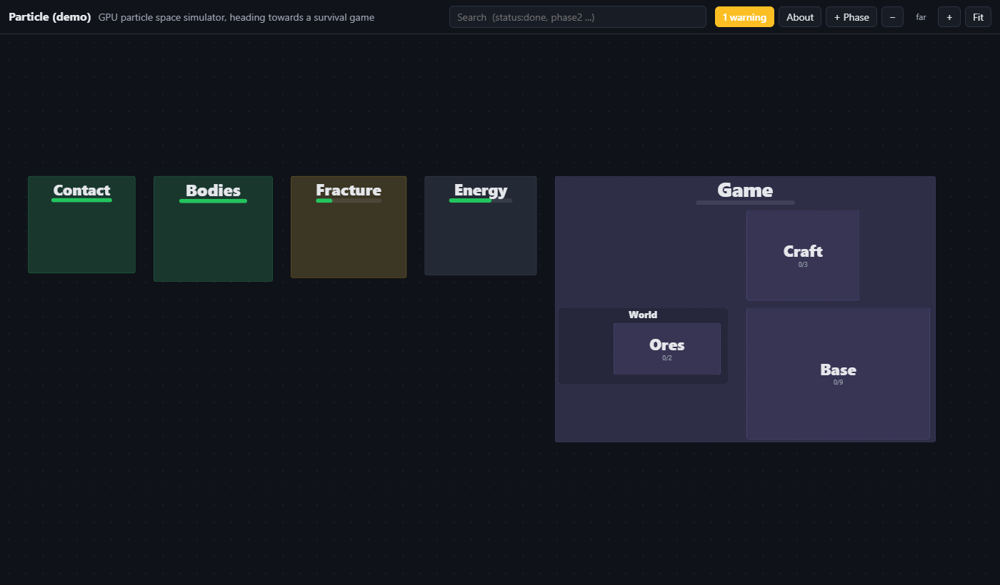
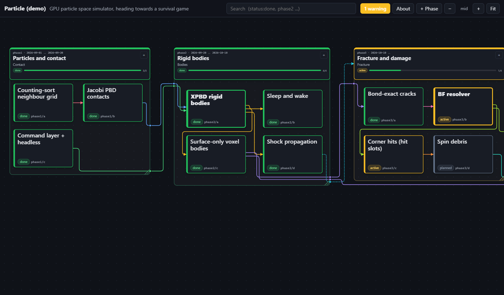
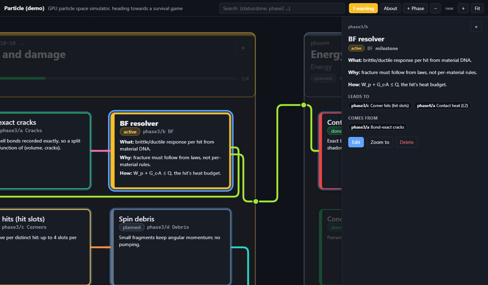
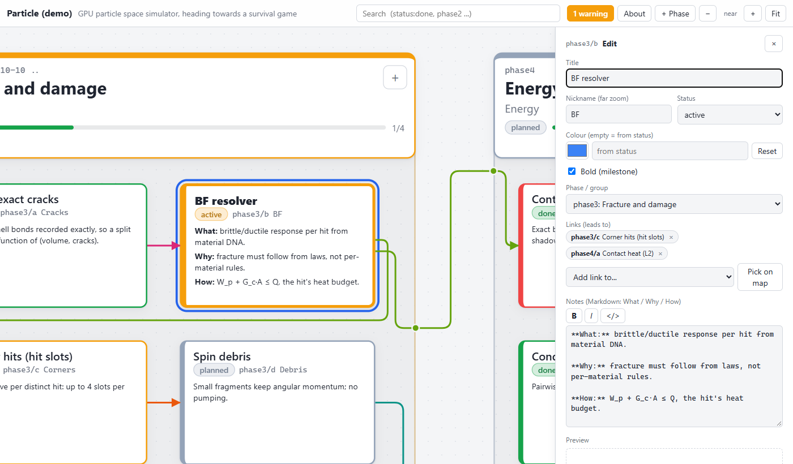
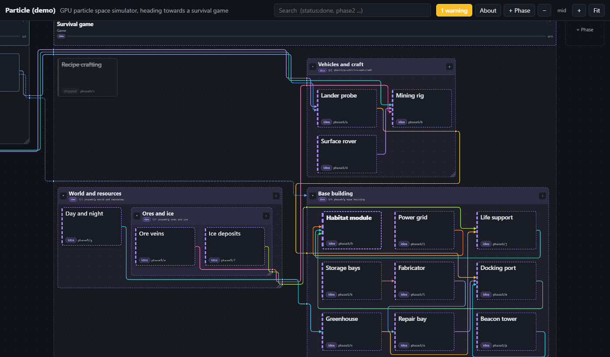
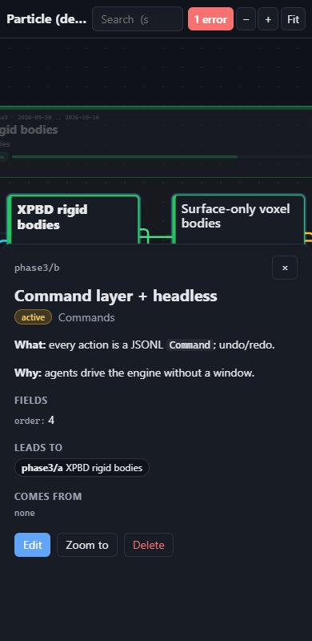

# WebRoadmap

A portable, local, interactive roadmap for any project. The roadmap is a plain folder of
Markdown files (`docs/roadmap/`) that people, coding agents and git all edit; `roadmap serve`
shows it as a zoomable left-to-right box map you can also edit in the browser.

| Far: phases | Mid: items and links | Near: full notes |
|---|---|---|
|  |  |  |





- **Phases are boxes left to right**; inside each, items and groups sit in a near-square grid
  (about sqrt(n) columns, filled row by row) that grows sideways and downwards.
- **Links are routed like wires:** out of an item's right side, through the gaps between boxes,
  across a phase or group border at a dot, and into the target's left side. Each source item's
  links have their own colour; every link has its own lane and the gaps widen to fit them, so
  lines never run through boxes or pile up on a border. A link that skips a phase runs just
  below the phases it passes.
- **Drag and drop:** drag an item or group header into any phase or group (a blue bar shows
  where it lands), or a phase header between phases. **Resize** a phase or group by its
  corner: the column count follows the width. Both are saved to the files.
- **Groups** break a big phase up: named rectangles of related items, nestable to any depth,
  each with its own status colour, progress count and collapse arrow. Item ids stay the same
  when items move between groups.
- **Semantic zoom:** far = phase blocks (and group blocks) with nickname, name and a progress bar; mid = item
  titles, status chips and arrows; near = the whole box with its What/Why/How notes (Markdown).
- **Status colours:** done green, active amber, planned grey, idea dashed purple, dropped faded and
  struck through; any entry can override its colour; `bold: true` marks milestones.
- **Live:** the page follows the files on disk within a second (agent edits, `git pull`). If
  you are mid-edit it shows a "changed on disk" notice instead of overwriting your form.
- No build step, no dependencies: Python standard library + plain HTML/CSS/JS.

## Install

Needs [uv](https://docs.astral.sh/uv/).

```sh
uv tool install C:\path\to\WebRoadmap        # or: uv tool install git+https://github.com/Fwogg3r/WebRoadmap
roadmap --version
```

Update after pulling: `uv tool install --reinstall C:\path\to\WebRoadmap`.

## Start a roadmap in a project

```sh
cd my-project
roadmap init              # creates docs/roadmap/ with roadmap.md and a sample phase1/a
roadmap serve             # prints http://127.0.0.1:8790 (first free port from 8790); opens nothing
```

Open the printed URL yourself (`roadmap serve --open` opens it for you). `roadmap` finds
`docs/roadmap/` by walking up from the current folder; `--dir PATH` points elsewhere.
`examples/demo/` is a sample roadmap: `roadmap --dir examples/demo/docs/roadmap serve`.

## The folder

```
docs/roadmap/
  roadmap.md          title, subtitle (frontmatter) + intro text
  phase1/phase.md     a phase: name, nickname, status, color, dates, width, height + summary
  phase1/a/item.md    a box: title, nickname, status, color, bold, links, done, refs, order + notes
  phase2/g-solver/group.md      a group inside phase2: name, nickname, status, color, order, width, height + summary
  phase2/g-solver/c/item.md     an item in that group: still phase2/c
  phase2/g-solver/g-tuning/...  a group nested inside it
```

Ids: `phase3` (phase), `phase3/b` (item), `phase3/g-solver` (group). An item's id is its phase
plus its letter, whatever group folder it sits in (letters are unique per phase), so moving it
between groups never breaks a reference. `links: [phase4/a, phase5, phase4/g-solver]` are
outgoing edges to items, whole phases or whole groups. Unknown frontmatter keys are preserved.
Full spec: [FORMAT.md](FORMAT.md).

**Layout:** every phase and group lays out its items and sub-groups (mixed, in `order:`) as a
near-square grid, row by row. `width:` / `height:` in `phase.md` / `group.md` (set by dragging
the corner, cleared by double-clicking it) choose how many columns fit and give a minimum size;
without them the size is automatic. Phases each take their own height.

## Editing in the browser

- **Click** a box or phase header: side panel with the rendered notes, outgoing (*Leads to*)
  and incoming (*Comes from*) links, problems.
- **Edit:** title/name, nickname, status, colour (picker, or *Reset* to the status colour),
  bold, phase / group (moves the item: within a phase its id stays, to another phase it gets a
  new letter and links are rewritten), links (pick from the dropdown, or
  *Pick on map* and click the target box), Markdown notes with a live preview
  (**B**/*I* buttons, Ctrl+B, Ctrl+I; Ctrl+S or Ctrl+Enter saves).
- **Move:** drag an item or a group header (mouse or pen) and drop it in any phase or group:
  the blue bar shows the grid position. Within a phase only the folder and `order:` change;
  into another phase the item gets a free letter there and every link to it is rewritten
  (`roadmap arrange`). Drag a phase header between two phases to reorder phases (`roadmap mv`).
  Esc cancels a drag. Dragging empty space still pans.
- **Resize:** drag the corner handle of a phase or group; the grid reflows as you drag and the
  size is saved as `width:`/`height:`. Double-click the handle (or *Automatic size* in the
  panel) to go back to automatic.
- **Add:** the `+` in a phase's header adds an item; `+ Phase` (top bar, or the column after
  the last phase) adds a phase; a phase's *+ Phase after* inserts one and renumbers the later
  folders, rewriting every link. *←/→* move a phase.
- **Groups:** a phase's or group's *+ Group* asks for a name (the id is made from it) and adds a
  group; *Edit* renames it (the id stays), sets nickname, status (or *from items*), colour and
  where it sits (phase or another group). The `+` in a group's header adds an item to it, the
  arrow collapses/expands it (remembered per browser); links to items in a collapsed group end
  at its header. Deleting a group asks first and removes everything inside it.
- **Delete** (with confirmation) removes the entry and every link to it.
- Hovering or selecting a box highlights its whole upstream and downstream chain (its links
  thicken in their own colours, the rest fade).
- **Search** (`/`): text in titles, notes and ids; `status:active` filters by status; Enter
  jumps to the next hit.
- Validation problems (dangling links, unknown status, missing files) show as a red button in
  the top bar and a red outline/`!` on the box.

## Controls

| | Mouse / keyboard | Touch |
|---|---|---|
| Pan | drag empty space with the left button, or anywhere with the middle button; arrow keys (Shift = faster) | one-finger drag (also after tap-and-hold) |
| Move an item, group or phase | drag it (mid/near zoom); Esc cancels | |
| Resize a phase or group | drag its bottom-right corner; double-click = automatic | |
| Zoom | wheel about the cursor; Ctrl+wheel / trackpad pinch; `+` `-` | two-finger pinch |
| Sideways | Shift+wheel | |
| Fit all | `0` or *Fit* | *Fit* |
| Zoom to a box or group | double-click | |
| Collapse / expand a group | the arrow in its header | tap the arrow |
| Close panel / cancel link pick | Esc | × |

The view is remembered per roadmap (browser storage). URL hash parameters make shareable
views: `#zoom=far|mid|near|fit|0.8&focus=phase3/b&select=phase3/b&edit=phase3/b`.

## Agents: CLI and Claude skill

Every command takes `--json` for machine-readable output; the HTTP API (`POST /api/<op>`)
runs the same Python functions, so the page and the CLI always agree.

```sh
roadmap list [--json]                 # tree: groups (#) indented under their phase, items under them
roadmap show phase3/b
roadmap add phase3 --title "Swept contact" --nickname Sweep --status planned --link phase4/a --body-file notes.md
roadmap add-phase --name "Energy" --nickname Energy [--after phase2]     # phase0 = insert first
roadmap set phase3/b status=done done=2026-11-03 body=@notes.md          # key= removes a field
roadmap link phase3/b phase4/a        # roadmap unlink A B
roadmap add-group phase3 --name "Solver" --nickname Solver [--in phase3/g-core] [--status active]
roadmap add phase3 --title "Warm start" --group phase3/g-solver          # new item straight into a group
roadmap mv phase3/b phase3/g-solver   # into a group of the same phase: id unchanged
roadmap mv phase3/b phase3            # back to the phase top level: id unchanged
roadmap mv phase3/b phase5            # item to another phase (prints the new id)
roadmap mv phase3/g-solver phase3/g-core   # a whole group (into another group or a phase)
roadmap mv phase5 2                   # phase to position 2: renumbers folders, rewrites links
roadmap set phase3/g-solver name="Solver core" status=     # rename (id stays); status= -> from items
roadmap renumber                      # close gaps after hand edits
roadmap rm phase3/b                   # removes links to it too
roadmap rm phase3/g-solver [--force]  # a group: refused while it holds anything, unless --force
roadmap check                         # exit 1 on errors
```

`roadmap install-skill` copies the bundled Claude skill (`src/webroadmap/skill/SKILL.md`,
name `roadmap`) to `~/.claude/skills/roadmap/` (overwrites, with a version header), so Claude
Code uses the CLI when asked to add or update roadmap entries or mark phases done.

### Keeping it current

`roadmap init` adds a managed "every change updates the roadmap" rule to the project's
`CLAUDE.md` (created if missing; `--no-agent-rule` skips it). For a project that already has a
roadmap, run `roadmap agent-rule` (`--file AGENTS.md` for other agents). The block sits between
`<!-- roadmap-rule:start -->` / `<!-- roadmap-rule:end -->` markers, so re-running refreshes it in
place after a WebRoadmap update; line endings are kept. It tells agents to set an entry's status
when work starts or finishes, add outcomes to its Notes, add entries for new work, and run
`roadmap check` before committing, in the same commit as the change.

`roadmap serve` does not create anything: without a `docs/roadmap/` above the current folder it
stops and points at `roadmap init`, so running it from the wrong folder can't scatter roadmaps.

## Phone / LAN

`roadmap serve --host 0.0.0.0` listens on every interface and prints the LAN address. There is
**no authentication**: anyone on the network can edit the roadmap, so only do this on a trusted
network. The page works on a phone (bottom-sheet panel, touch pan and pinch).



## Development

```sh
uv run pytest                       # format round-trip, mutations, check, HTTP API
uv run tests/browser_check.py       # headless Chrome/Edge end-to-end check; rewrites docs/screenshots
uv run tests/browser_check.py --scheme light
```

The browser check never opens a visible window. Layout: `src/webroadmap/fmt.py` (frontmatter
parser/writer), `model.py` (every operation), `cli.py`, `server.py`, `static/` (the page).
